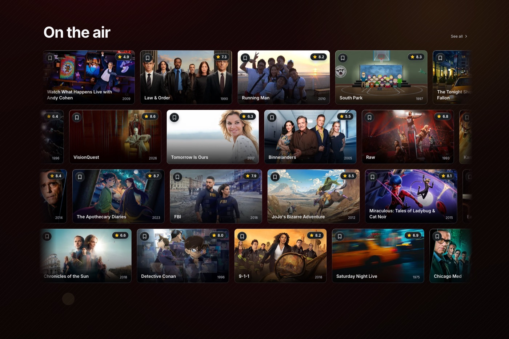
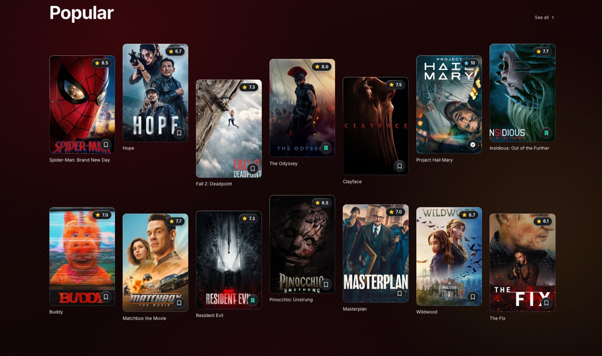
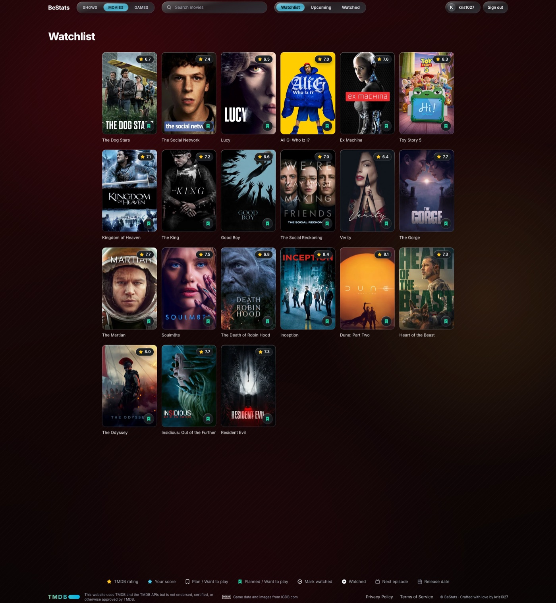
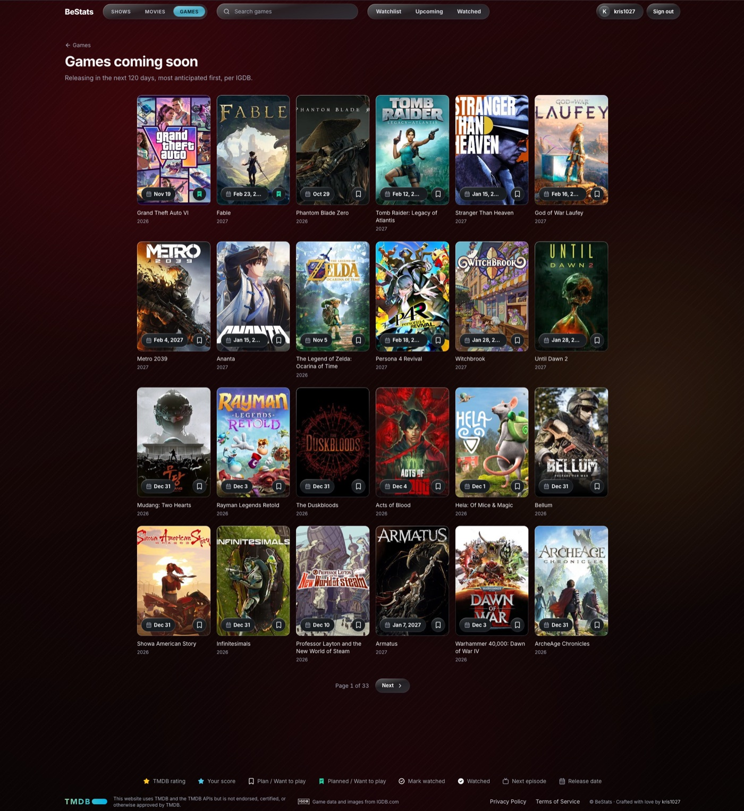

# BeStats

[](https://github.com/kris1027/BeStats/actions/workflows/checks.yml)

A tracker for TV shows, movies and games, inspired by TV Time. You browse and search the catalog, keep a private list of what you plan to watch or play, mark movies and episodes watched, and rate what you finish. BeStats tracks what you watch and play; it does not stream anything.

**Live:** [bestats-sable.vercel.app](https://bestats-sable.vercel.app)

TMDB supplies movie and TV metadata, IGDB supplies game metadata, and Supabase stores accounts and your private data. The stack and product rules live in [AGENTS.md](AGENTS.md); installed versions live in [package.json](package.json).

## What it does

- **Catalog:** public pages for shows, movies and games, each with a home page of carousels and paged lists (trending, popular, top rated and more), plus detail pages with cast, seasons and episodes.
- **Search:** title search with genre, year and minimum community rating filters, in shareable URLs, for all three media types.
- **Accounts:** email and password sign in, with a username you can change once a week. Google sign in is planned but not built yet.
- **Shows:** mark single episodes or whole seasons watched (only episodes that already aired), rate episodes from 1 to 10, and see season and show ratings calculated from your episode scores. Tracking a show is separate from your history, so stopping it keeps every mark and rating.
- **Movies:** plan a movie, or mark it watched and rate it from its release day.
- **Games:** set Want to play, Playing or Finished by hand, and rate a game once you play it.
- **Library:** three pages, Watchlist, Upcoming and Watched, with a SHOWS | MOVIES | GAMES tab on each. Shows and movies land on the right page by themselves, based on what you watched and what has aired; games follow the status you set.

Every personal rating is kept apart from the TMDB or IGDB community rating, and is labelled that way.

## Development status

Every planned feature has shipped: features 1 to 25 in the [movie and TV scope](docs/scope/scope.md) and G1 to G10 in the [games scope](docs/scope/games.md). Work now happens in small follow up changes. The decisions behind each feature are in [docs/specs/](docs/specs/), and the plans for smaller changes in [prompts/](prompts/).

## Screenshots

Captured on 2026-10-28 from the running app with live TMDB and IGDB content. Catalog titles and ratings change over time.

**Shows home:** the On the air carousel, with TMDB community ratings and a plan button on each card.



**Movies home:** the Popular carousel. A filled bookmark marks a planned movie, a check a watched one, and a blue star your own score.



**Watchlist:** your planned movies, signed in, with the SHOWS | MOVIES | GAMES tabs and the Watchlist, Upcoming and Watched pages in the navbar.



**Games coming soon:** upcoming releases from IGDB with their release dates, one of the paged game lists.



## Local setup

You will want Node.js 22 (the version CI and Vercel use) and the pnpm version pinned in the `packageManager` field of [package.json](package.json). A running Docker compatible container runtime is needed for local Supabase and the database tests.

From a clone of this repository:

```sh
pnpm install --frozen-lockfile
cp .env.example .env.local
```

If `.env.local` already exists, update it from the example instead of overwriting it. The committed [.env.example](.env.example) explains each setting and where to get it. Keep real credentials in the ignored local file.

### Credentials

- **TMDB:** an API Read Access Token, for movie and TV pages.
- **IGDB:** the Client ID and Client Secret of a Twitch application, for game pages. The example file walks you through creating one.

Both stay on the server and never reach the browser.

### Start local Supabase

The CLI and project configuration are already in the repo, so you can skip `supabase init`. With your container runtime running, you can run from the repository root:

```sh
pnpm exec supabase start
pnpm exec supabase status
```

The first start downloads the container images and applies the migrations and the local seed. Local Studio is at [127.0.0.1:54323](http://127.0.0.1:54323), and Mailpit, which catches confirmation and recovery emails, is at [127.0.0.1:54324](http://127.0.0.1:54324).

To rebuild the database from the migrations and seed, run `pnpm exec supabase db reset`. It erases local data only. It is also worth running before `pnpm test:db`, since leftover test data can make the database tests fail.

See the [Supabase local development guide](https://supabase.com/docs/guides/local-development/cli/getting-started) for container runtime setup. These commands start local services only; they never touch the cloud project.

### Start the app

```sh
pnpm dev:docker
```

This runs the development server against the local Supabase stack, starting the stack first if it is not running. It sets the local URL, the publishable key and a site URL of `http://localhost:3000` for this process only, and those win over `.env.local`; everything else, such as the TMDB and IGDB credentials, still comes from `.env.local`. Extra arguments go to `next dev`. A port other than 3000 is refused, because the local auth redirect allow list in `supabase/config.toml` only covers that origin.

Use plain `pnpm dev` when `.env.local` points at the project you want, such as a cloud project. That project needs the migrations in [supabase/migrations/](supabase/migrations/) applied, or every tracking read fails.

Open [localhost:3000](http://localhost:3000). `/` redirects to `/shows`; movies are at `/movies` and games at `/games`. The `/showcase` page shows the UI components and their states.

#### Local test accounts

The seed creates two confirmed users on the local stack. The database tests use them, and they are handy for trying sign in and tracking:

| Email | Password |
| --- | --- |
| `user-a@example.test` | `password-a` |
| `user-b@example.test` | `password-b` |

They exist only locally and are never applied to a deployed project.

## Everyday commands

| Command | Purpose |
| --- | --- |
| `pnpm dev` | Start the development server with the settings in `.env.local`. |
| `pnpm dev:docker` | Start the development server against the local Supabase stack. |
| `pnpm typecheck` | Generate route types and check TypeScript. |
| `pnpm lint` | Check formatting and lint rules with Biome. |
| `pnpm lint:ci` | The same check as CI, failing on warnings too. |
| `pnpm format` | Apply Biome formatting and fixes. |
| `pnpm test` | Run the fixture based tests; no live providers or credentials needed. |
| `pnpm test:db` | Run the pgTAP database tests against the local Supabase stack. |
| `pnpm db:types` | Regenerate the database types from local Supabase. |
| `pnpm db:types:check` | Check the generated database types still match local Supabase. |
| `pnpm tmdb:live` | Run the opt in live TMDB checks; needs network access and a real token. |
| `pnpm igdb:live` | Run the opt in live IGDB checks; needs network access and real Twitch credentials. |
| `pnpm build` | Create a production build. |
| `pnpm start` | Serve an existing production build. |

The live checks read their credentials from the environment or `.env.local` and skip when none are set. A placeholder is not a valid credential, and passing fixture tests does not prove a live integration works.

[CI](.github/workflows/checks.yml) runs type checking, linting, the fixture tests and a production build on Node 22. The database tests run when files under `supabase/` change.

## Deployment

Vercel hosts the app in Frankfurt (`fra1`), next to the Supabase project in `eu-central-1`. Schema and auth settings reach the cloud only from this repo, through `supabase db push` and `supabase config push`. The runbook is [docs/deploy.md](docs/deploy.md).

## Repository map

| Path | Contents |
| --- | --- |
| [app/](app/) | App Router pages, Server Actions, metadata routes and global styles. |
| [components/](components/) | Shared UI built on shadcn/ui and the glass design system. |
| [lib/tmdb/](lib/tmdb/) | Server only TMDB access, caching, normalization and fixtures. |
| [lib/igdb/](lib/igdb/) | Server only IGDB access, token handling, catalog filter and fixtures. |
| [lib/supabase/](lib/supabase/) | Browser and server clients, plus the generated database types. |
| [lib/](lib/) | Auth, tracking, rating and library rules, SEO, legal facts and helpers. |
| [proxy.ts](proxy.ts) | Request middleware: session refresh and early 404s. |
| [supabase/](supabase/) | Local configuration, declarative schemas, migrations, seed and database tests. |
| [docs/](docs/) | Scopes, specs, reviews, the deploy runbook and screenshots. |
| [prompts/](prompts/) | Implementation plans prepared for approval. |
| [.github/](.github/) | CI, issue forms and the pull request template. |

## Working on BeStats

This is a solo project built with the help of AI agents. Before you change anything, it helps to read [AGENTS.md](AGENTS.md) and the `AGENTS.md` in the folder you are touching. The usual loop is: write a plan in `prompts/`, get it approved, implement it, then report the checks you actually ran.

Work on a `feat/<slug>` branch and merge through a pull request. Changes to `main` need passing CI and an up to date branch; no approving reviewer is required. [Issue forms](https://github.com/kris1027/BeStats/issues/new/choose) capture bugs and features with observable acceptance criteria, and blank issues stay available for anything else.

## Credits

Movie and TV data comes from [TMDB](https://www.themoviedb.org) and game data from [IGDB](https://www.igdb.com). TMDB's required notice and the IGDB credit are in the app's footer and on its `/terms` page.
